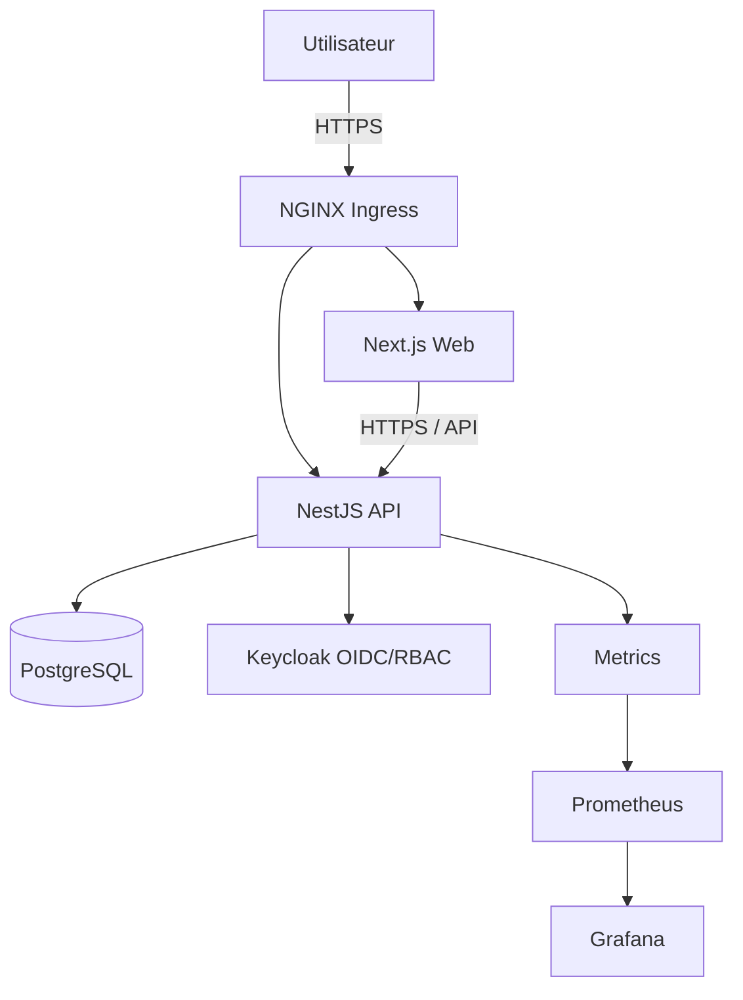
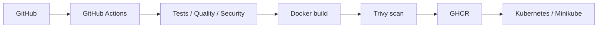

# Architecture — référence historique et état microservices

## Décision initiale (historique)

La V1 utilise un **monolithe modulaire conteneurisé**. Une architecture microservices n'est pas retenue pour le POC car elle augmenterait fortement la complexité d'exploitation sans bénéfice démontré pour le périmètre initial.

## Vue logique



## Modules backend prévus

- Auth / Security
- Listings
- Moderation
- Health
- Observability

## Déploiement cible POC



## API initiale

- `POST /api/listings`
- `GET /api/listings`
- `GET /api/me/listings`
- `PATCH /api/listings/:id`
- `GET /api/moderation/listings?status=PENDING`
- `POST /api/moderation/listings/:id/approve`
- `POST /api/moderation/listings/:id/reject`
- `GET /health/live`
- `GET /health/ready`

## Données minimales

`Listing` : id, ownerId, title, description, operationType, status, createdAt, updatedAt, moderationReason.

`operationType` : TRADE | DONATION.

`status` : PENDING | APPROVED | REJECTED.

## Production

Minikube est un environnement de démonstration. Une production réelle nécessiterait notamment une cible européenne managée, haute disponibilité, sauvegardes, gestion de secrets renforcée, réseau contrôlé, supervision/alerting et reprise après sinistre.


## Architecture effectivement livrée — 12 octobre 2026

Le POC a évolué du **monolithe modulaire initial** vers une migration Strangler **M0–M9 terminée et fusionnée**. Le schéma initial ci-dessus est conservé comme contexte de décision et **ne représente pas l'architecture runtime actuelle**.

```text
Next.js Web (:3001) ── /api ──► Gateway (:3000) ──► Catalog (:3101) ──► MinIO
                                    │                     └► PostgreSQL/catalog
                                    ├────► Marketplace (:3102) ──► PostgreSQL/marketplace
                                    │                 │
                                    │                 └────► RabbitMQ ──► Notification (:3103)
                                    │                                        └► PostgreSQL/notification
                                    └────► Legacy API (:3099), fallback Strangler vers PostgreSQL/public
Keycloak (OIDC/JWT) sert de fournisseur d'identité transversal aux utilisateurs et aux APIs.
```

**Frontières vérifiées :** aucun Prisma client Catalog importé dans Marketplace ; appels internes Catalog authentifiés, propagation JWT via Gateway ; Notification consomme RabbitMQ sans jointure SQL métier inter-service. Docker Compose et Kubernetes déploient les workloads indépendamment.

Références : [migration #44](https://github.com/BALLOPROTEL/Projet_indiV26-espace-com-troc-don/issues/44), [M7 Kubernetes](20-m7-kubernetes-microservices.md), [M8 E2E](21-m8-microservices-contracts-e2e.md), [M9 DONE](22-m9-donation-trade-workflows.md).

**M10 demeure à faire** : diagrammes C4 finaux et de séquence au format de la soutenance, détaillant modes de panne, réservations, outbox, déduplication et rollback. Issue [#57](https://github.com/BALLOPROTEL/Projet_indiV26-espace-com-troc-don/issues/57).
