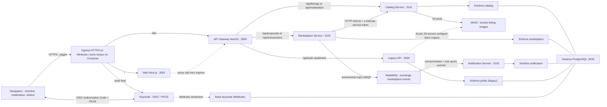
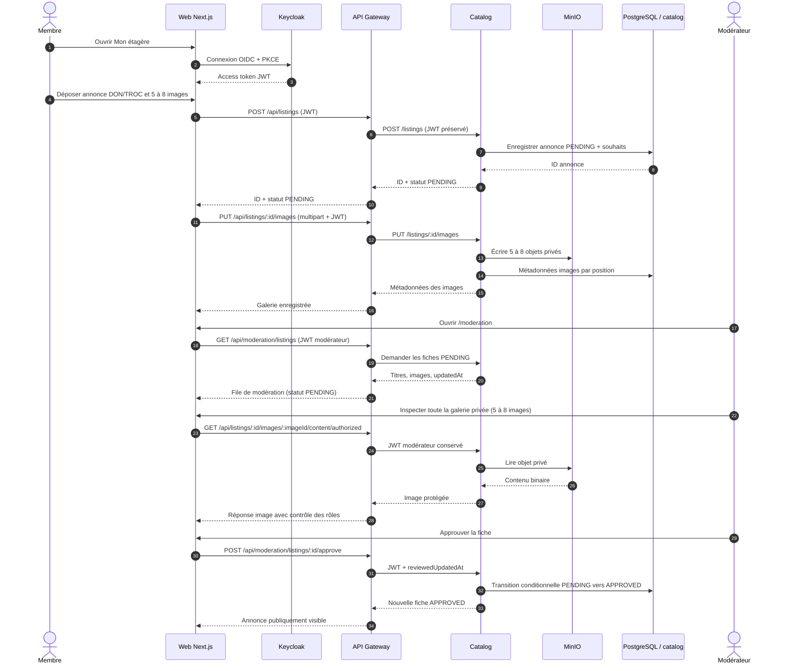
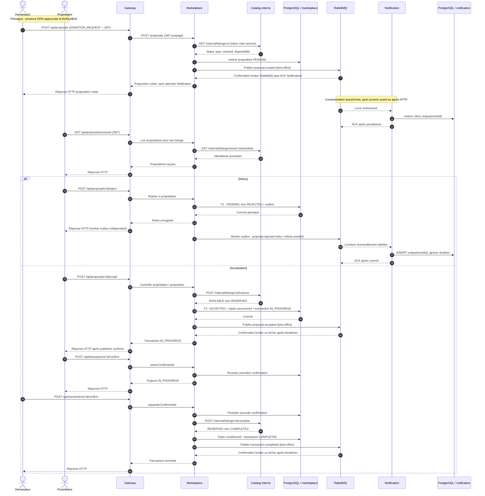
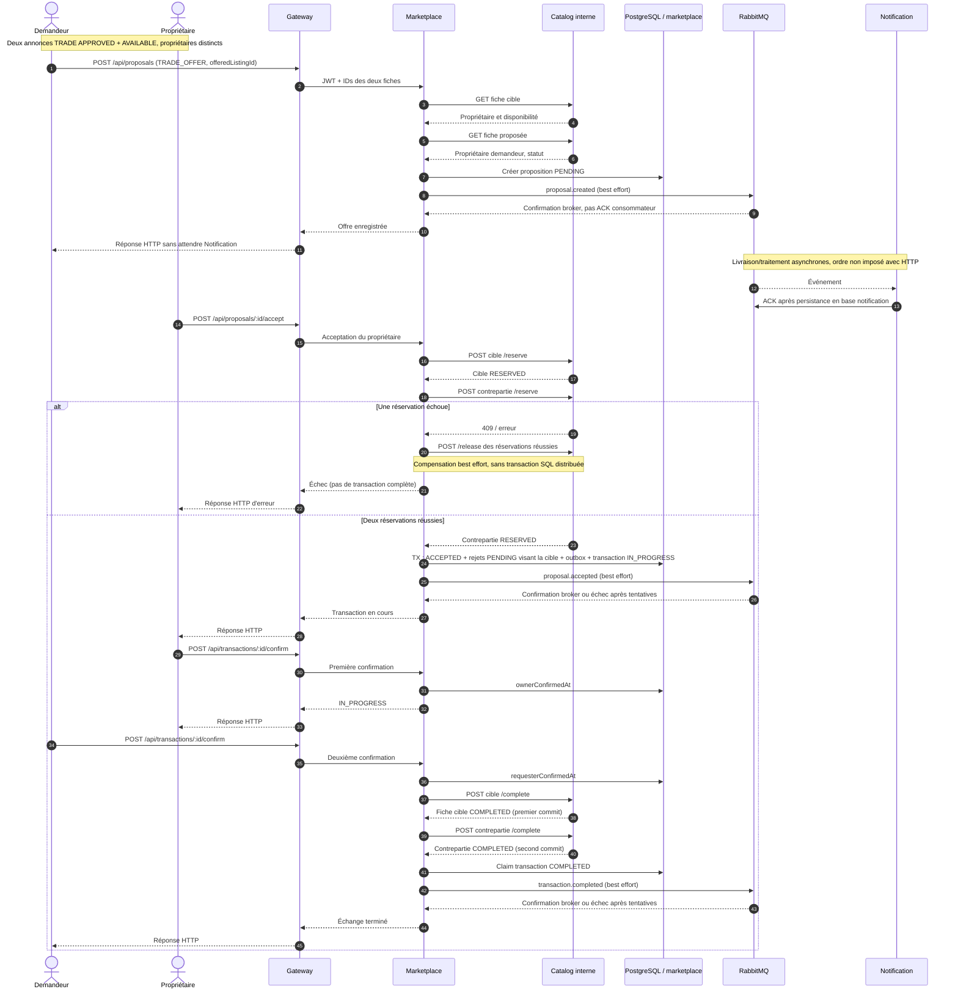
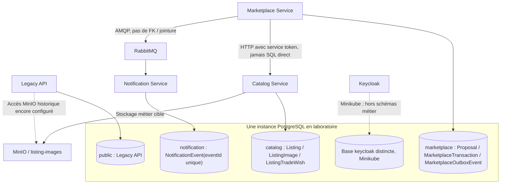
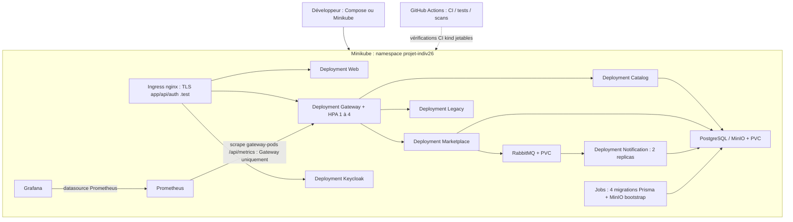

# M10 — Architecture microservices finale (état réel, octobre 2026)

> **Référence de soutenance technique — issue [#57](https://github.com/BALLOPROTEL/Projet_indiV26-espace-com-troc-don/issues/57), epic [#44](https://github.com/BALLOPROTEL/Projet_indiV26-espace-com-troc-don/issues/44).** Diagrammes **Mermaid éditables et affichés par GitHub** ; décrivent le code de `main` après fusion de [#60](https://github.com/BALLOPROTEL/Projet_indiV26-espace-com-troc-don/pull/60) et [#61](https://github.com/BALLOPROTEL/Projet_indiV26-espace-com-troc-don/pull/61), et non une architecture cible imaginaire. Les limites sont volontaires et documentées.

**Périmètre :** application Next.js, API Gateway NestJS, Catalog Service, Marketplace Service, Notification Service, Keycloak, RabbitMQ, PostgreSQL, MinIO, Legacy API du modèle Strangler, Docker Compose, Minikube/kind, Prometheus/Grafana. Les figures ci-dessous représentent des **flux logiques** ; elles ne prétendent pas à un réseau sécurisé par NetworkPolicies ou à une HA de production.

## 1. Diagramme de conteneurs — vue logique type C4 (niveau 2)

**Interprétation :** les services partagent une **instance PostgreSQL de laboratoire** avec **schémas Prisma distincts** ; aucune jointure ni relation SQL interservices n'est implémentée **dans les nouveaux services**. Cette séparation est une **convention de code et de schéma Prisma**, **pas** une isolation de permissions SQL : les quatre URLs métier utilisent le même rôle PostgreSQL `app` (Compose) ou un même principal généré (Minikube), qui pourrait accéder à plusieurs schémas si un service était compromis. **Dans Minikube, ce principal possède aussi la base d'identité `keycloak`** : le risque inclut l'altération des comptes/rôles et pas seulement la lecture croisée des schémas métier. Les références d'annonces circulent par identifiant et contrat HTTP. En **Compose**, Keycloak démarre en `start-dev --import-realm` sans base PostgreSQL Keycloak dédiée ; en **Minikube**, il dispose de la **base PostgreSQL distincte `keycloak`** (et non d'un schéma Prisma). Le dessin différencie cette particularité.

**Routage réellement en place :** `apps/gateway/src/routes.ts` route seulement `/api/listings*` et `/api/moderation/listings*` vers Catalog, `/api/proposals*` et `/api/transactions*` vers Marketplace, `/api/auth*` vers Legacy et `/api/health/{live,ready}` et `/api/metrics` vers Gateway. **Le Gateway ne bascule pas automatiquement toute route inconnue vers Legacy** : le « fallback Strangler » est un routage résiduel explicite. **Attention :** le processus Legacy inclut encore ses modules `ListingsModule` et `MarketplaceModule` et conserve des credentials PostgreSQL `public` et MinIO lecture/écriture. Ces capacités sont encore joignables **directement sur le service local/ClusterIP**, même si le Gateway public ne les route pas ; c’est une dette de confinement et de retrait, pas une isolation technique absolue.

## 2. Parcours de publication et de modération — prérequis des transactions

**Garde-fous vérifiés :** signature MIME, taille maximale de 5 MiB par image, 5–8 images et 5–10 souhaits TROC ; refus d'approbation incomplète, propriété des médias, autorisation `MODERATOR` / `ADMIN`, anti-stale `reviewedUpdatedAt`. **L’ouverture de la galerie par un modérateur est une bonne pratique du scénario de recette, non une précondition imposée par l’API d’approbation** : celle-ci exige le nombre d’images et les règles de fiche, sans preuve de lecture effective. Les tests Chrome et API de [#61](https://github.com/BALLOPROTEL/Projet_indiV26-espace-com-troc-don/pull/61) incluent la relecture binaire des 15 images après les uploads successifs.

## 3. Séquence DON — succès, refus et notifications

**Nuance impérative :** seuls les événements `proposal.rejected` (refus explicite et refus automatiques lors d'une acceptation) passent aujourd'hui par une **outbox transactionnelle PostgreSQL** ; `proposal.created`, `proposal.accepted` et `transaction.completed` sont publiés **après** les écritures métier via le publisher RabbitMQ, sans garantie outbox équivalente. RabbitMQ utilise des confirmations de publication, et Notification persiste une inbox avec `eventId` unique ; **cela n'élimine pas le risque d'événement manquant côté producteur hors outbox**.

## 4. Séquence TROC — deux annonces, réservations et compensation

**Attention aux propositions concurrentes :** lors d'un TROC, les rejets automatiques et événements outbox concernent **uniquement les autres propositions visant l'annonce cible** (`targetListingId`), et **non celles visant l'annonce proposée en contrepartie** : ces dernières peuvent rester `PENDING` alors que la contrepartie a été réservée. Un futur travail de cohérence/reconciliation doit traiter ce cas.

**Important :** le code effectue les deux changements Catalog successivement ; s'il échoue après le premier `complete`, aucune **transaction distribuée** n'annule automatiquement cette première clôture. Les réservations ont une compensation `release` *best effort* en cas d'échec d'acceptation ; l'état partiellement clos exige diagnostic et réparation opérateur. Les claims SQL conditionnels limitent les doubles transitions mais ne valent pas exactement-once interservices.

## 5. Propriété des données — frontières réelles

| Propriétaire | Modèles / actifs | Accès autorisé | Interdit architecturalement |
| --- | --- | --- | --- |
| Catalog | Annonces, images (métadonnées), souhaits, modération, disponibilité | Prisma schema `catalog`, MinIO privé | Marketplace ne lit pas les tables Catalog directement ; **pas d’isolation SQL par rôle** |
| Marketplace | Propositions, statuts, transactions, confirmations, outbox de refus | Prisma schema `marketplace`, API Catalog interne, RabbitMQ | Pas de FK SQL sur `catalog.Listing` |
| Notification | Événements reçus, `eventId` unique, timestamp | Prisma schema `notification`, RabbitMQ, endpoint `/notifications/recent` de labo | Ne modifie pas les annonces ni les transactions |
| Legacy | Routes d’auth exposées via Gateway, **mais modules Listings et Marketplace historiques encore actifs dans le processus** | Prisma schema `public` et **credentials S3/MinIO toujours présents** ; accès direct possible sur `:3099` local ou ClusterIP | Ne doit pas redevenir le backend des nouveaux flux ; retrait et réduction des accès restent à faire |
| Keycloak | Comptes, rôles et realm | OIDC + JWKS ; base `keycloak` **dans Minikube uniquement** | Pas de dépendance FK métier sur les tables Keycloak |

## 6. Frontières de confiance, routing et droits

| Flux | Contrat réel | Contrôle de sécurité | Référence dans le dépôt |
| --- | --- | --- | --- |
| Navigateur ↔ Keycloak | OIDC Authorization Code + PKCE | Authentification utilisateur, issuer/audience JWT | `apps/web/lib/keycloak.ts` et `infra/keycloak/projet-indiv26-realm.json` |
| Navigateur → Gateway | `/api/*`, JWT Bearer transmis | CORS, en-têtes de sécurité, proxy 15 s ; **pas de JWT validé par Gateway** | `apps/gateway/src/main.ts`, `proxy.ts` |
| Gateway → Catalog (public) | `GET /api/listings`, `GET /api/listings/:id`, et GET médias publics d’annonces approuvées | **Sans JWT** pour ces lectures publiques, Catalog filtre les annonces et images non approuvées | `apps/catalog-service/src/listings/listings.controller.ts`, `listing-images.controller.ts` |
| Gateway → Catalog (protégé) | Création, édition, upload privé, galerie autorisée et `/api/moderation/listings*` | **JWT vérifié par Catalog**, rôle MODERATOR/ADMIN pour modération, propriétaire pour médias privés | `apps/catalog-service/src/auth`, `apps/catalog-service/src/listings` |
| Gateway → Marketplace | `/api/proposals*`, `/api/transactions*` → routes sans `/api` | JWT vérifié **par Marketplace** et contrôles métier propriétaire/participants | `apps/marketplace-service/src/proposals` et `transactions` |
| Gateway → Legacy | **`/api/auth*` uniquement via Gateway** ; autres contrôleurs Legacy non routés par Gateway mais **encore joignables directement** sur son port local/ClusterIP | Dette Strangler et surface legacy résiduelle (PostgreSQL public + MinIO) | `apps/gateway/src/routes.ts`, `apps/api/src/app.module.ts`, `compose.yaml` |
| Marketplace → Catalog | `/internal/listings/:id`, `/reserve`, `/complete`, `/release`, `/owner/:id/ids` | `x-internal-service-token` partagé, comparaison timing-safe | `catalog-client.service.ts`, `internal-service.guard.ts` |
| Marketplace → RabbitMQ | Exchange topic `marketplace.events` | URL et credentials RabbitMQ de labo ; publisher confirms ; refus via outbox | `apps/marketplace-service/src/events` |
| RabbitMQ → Notification | Queue durable `notification.marketplace-events.v1` | Contrat v1, déduplication PostgreSQL, ACK après commit | `apps/notification-service/src/rabbitmq/rabbitmq.consumer.ts` |
| Catalog → MinIO | `listing-images`, objets privés | Appels serveur S3 ; public uniquement via routes Catalog après approbation | `listing-images.service.ts`, `infra/minio` |

**Note d'exposition :** en Docker Compose, des ports de services, le service Legacy complet et le `/notifications/recent` de laboratoire sont mappés sur `127.0.0.1` ; en Kubernetes, les services métiers, y compris **l’application Legacy complète**, sont sur ClusterIP, hors exposition Ingress directe. Le header de service partagé et la présence de ports locaux ne constituent **pas** une défense de production ; des contrôles réseau, l'identité de workload et des règles d'exposition supplémentaires restent nécessaires.

## 7. Déploiements et observabilité — ce qui est effectivement démontré

- **Compose :** services HTTP en ports locaux (`3000` Gateway, `3001` Web, `3099` Legacy, `3101` Catalog, `3102` Marketplace, `3103` Notification), Keycloak `8081`, MinIO `9000`, RabbitMQ et PostgreSQL. Dépendances de démarrage et checks santé dans `compose.yaml` ; migrations `legacy/catalog/marketplace/notification` et init MinIO.
- **Kubernetes :** `infra/k8s/minikube/kustomization.yaml`, Services ClusterIP, probes startup/liveness/readiness, requests/limits, Secrets générés hors dépôt, PostgreSQL/RabbitMQ/MinIO persistants, 4 Jobs Prisma. L'Ingress expose `app.projet-indiv26.test`, `api.projet-indiv26.test` et `auth.projet-indiv26.test` via TLS de **labo**, non un certificat public de production.
- **Observabilité :** Prometheus/Grafana collecte **les métriques du Gateway uniquement** via le job `gateway-pods` vers `/api/metrics` ; les autres services disposent de probes santé, **sans scrape Prometheus propre configuré**. JMeter et HPA de Gateway (CPU 60 %, 1–4 pods). Le `/api/health/ready` est agrégé pour diagnostic, alors que la readiness Kubernetes du Gateway utilise `/api/health/live`, par choix d'isolation.
- **Dans cette topologie, les événements passent exclusivement de Marketplace vers Notification par le broker RabbitMQ**, sans lien HTTP applicatif direct. Voir les séquences et les limites de la livraison aux sections 3, 4 et 8.

## 8. Risques et écarts POC / production — à annoncer au jury

| Risque / écart | Statut effectivement constaté | Ce que M10 ne prétend pas |
| --- | --- | --- |
| Outbox partielle | Outbox transactionnelle sur `proposal.rejected` uniquement ; autres événements publiés après commit | Pas d'exactly-once ni d'outbox universelle |
| Rétention événements | Inbox Notification conserve tous les `eventId` uniques ; outbox Marketplace conserve les rejets publiés avec `publishedAt` ; `recent()` n'extrait que 50 résultats, sans purge | Pas d'archivage, TTL ou quota de rétention automatique : prévoir capacité/alertes, durée de déduplication et purge compatible avec les retries |
| Cohérence distribuée | Réservations séquentielles, compensation `release` best effort ; clôture des annonces séquentielle | Pas de saga persistée / 2PC / reprise automatique complète |
| Legacy | Seul `/api/auth*` est routé par Gateway, mais modules Listings/Marketplace, base `public` et accès MinIO demeurent dans le service directement joignable | Pas de confinement effectif du legacy ni de retrait complet du monolithe |
| Isolation réseau / SQL | Pas de NetworkPolicy ; token partagé interservices, rôle PostgreSQL partagé entre les schémas métier **et la base Keycloak dans Minikube** | Pas de service mesh/mTLS ni de principal SQL dédié à l'identité ou de permissions limitées par service |
| Protection contre surcharge | HPA sur Gateway, protections ponctuelles, pas de rate limiter distribué démontré | Pas de quota global multi-replica certifié |
| Stockage / identité | PostgreSQL/MinIO/RabbitMQ PVC de labo ; Keycloak en `start-dev` (Compose et manifest Minikube) | Pas de HA multi-zone, sauvegarde automatique ni Keycloak prod durci |
| Accès et secrets | Secrets hors versionnage pour K8s ; Compose contient des identifiants explicitement **locaux** | Ne jamais réutiliser ces secrets en production |
| Observabilité | Prometheus scrute **Gateway seulement** ; probes des autres services et expérimentations JMeter | Ni couverture métriques de tous les services ni SLO de production |
| Frontend | Fonctionnel avec couverture Chrome ; refonte UX à venir **uniquement après GO** | M10 ne lance aucune amélioration frontend |

## 9. Vérification, preuves et séquence des prochains chantiers

**Sources de vérité** : `apps/gateway/src/routes.ts` ; `apps/marketplace-service/src/proposals/proposals.service.ts`, `transactions/transactions.service.ts`, `events/outbox.worker.ts` ; `apps/catalog-service/src/internal/internal-listings.controller.ts` ; `apps/notification-service/src/rabbitmq/rabbitmq.consumer.ts` ; les **quatre** schémas Prisma (`apps/api/prisma/schema.prisma`, `apps/catalog-service/prisma/schema.prisma`, `apps/marketplace-service/prisma/schema.prisma`, `apps/notification-service/prisma/schema.prisma`) ; `compose.yaml` et `infra/k8s/minikube`.

**Certifications précédentes** :
- [PR #61 — LOT 9B-F](https://github.com/BALLOPROTEL/Projet_indiV26-espace-com-troc-don/pull/61) (merge `53fb2df`) : [Bootstrap #38313602241](https://github.com/BALLOPROTEL/Projet_indiV26-espace-com-troc-don/actions/runs/38313602241) et [E2E Chrome #38313602213](https://github.com/BALLOPROTEL/Projet_indiV26-espace-com-troc-don/actions/runs/38313602213), revus sur HEAD `7e346cd`.
- [Guide M7 Kubernetes](20-m7-kubernetes-microservices.md), [M8 intégration](21-m8-microservices-contracts-e2e.md), [M9 DON/TROC](22-m9-donation-trade-workflows.md), [LOT 9B-F navigateur](23-lot9bf-certification.md).

**Ordre acté par le propriétaire :** ① terminer/revoir M10 ; ② **développement frontend après GO explicite** ; ③ seulement ensuite consolider les preuves LOT 10-A (#58) ; ④ préparer présentation/répétition/vidéo LOT 10-B (#59). **Aucune action M10 n'autorise le début du chantier frontend.**

Le guide opérationnel associé est [`25-m10-operations-limits.md`](25-m10-operations-limits.md). Les schémas précédents sont des fichiers Markdown avec blocs `mermaid` : ils sont affichés par GitHub et éditables dans la PR.
